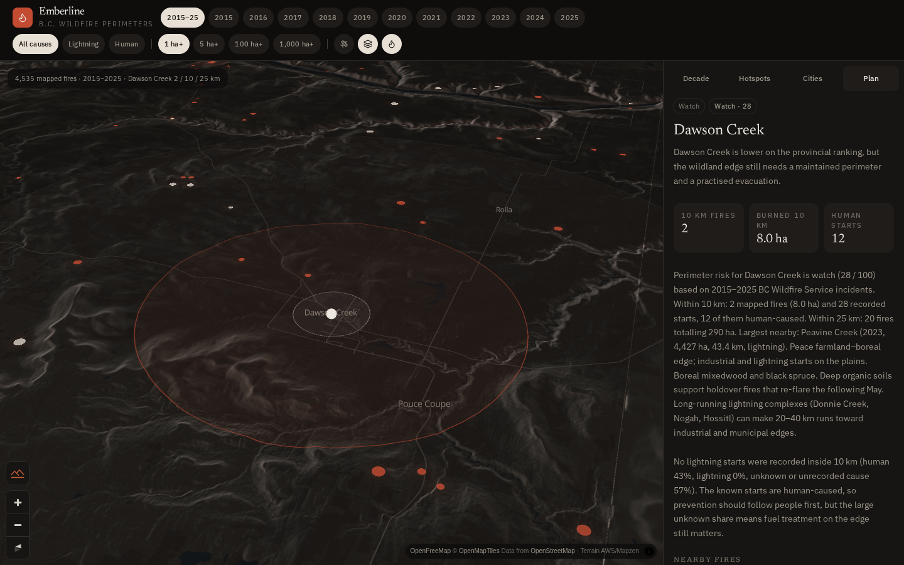
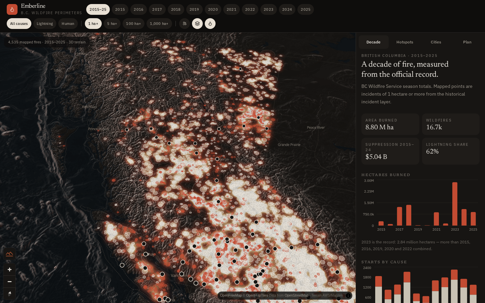
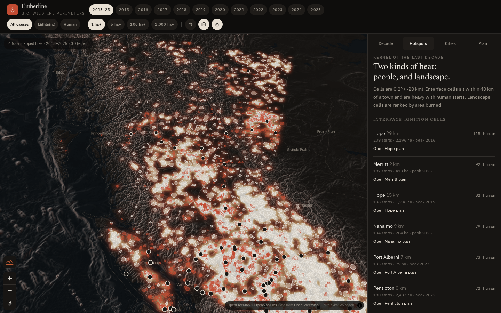
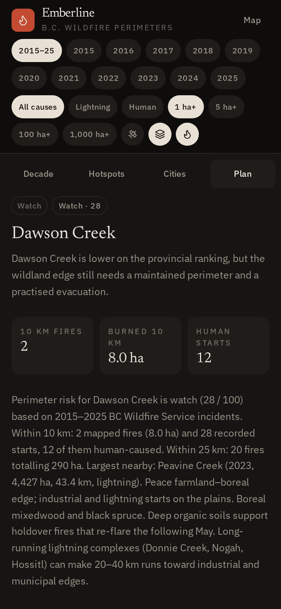

# Emberline

**A decade of British Columbia wildfires on one map, turned into a FireSmart perimeter plan for your town.**



Emberline maps 2015–2025 BC Wildfire Service incidents with MapLibre and shows where fires keep starting: by year, by cause (lightning or human) and by size. Pick a community and it turns the fire history within 10, 25 and 50 km into a plain-language FireSmart plan: a risk rating, the cause mix, nearby fires, actions for each zone, a month-by-month work calendar and the partners to call.

## Key numbers

| | |
|---|---|
| Recorded incidents, 2015–2025 | **30,750** |
| Mapped fires (≥ 1 ha) | **4,535** |
| Communities with a perimeter plan | **63** |
| Largest fire of the decade | **Donnie Creek, 2023: 619,072 ha** (NE BC, Peace / Fort Nelson area) |

## The four views

| View | What you get |
|---|---|
| **Decade** | Fires, hectares burned, cost and the human vs. lightning split for each year, with official BC Wildfire Service totals next to the mapped data. |
| **Hotspots** | About 0.1° grid cells ranked by where ignitions cluster, including small starts, with the peak year for each cell. |
| **Cities** | Search and rank 63 communities by fire exposure within 10, 25 and 50 km. Peace Region and NE BC are included: Dawson Creek, Fort St. John, Chetwynd, Fort Nelson, Mackenzie. |
| **Plan** | A copyable FireSmart perimeter plan per community covering the situation, ignition pattern, zone actions, a seasonal calendar and partners. |

Map controls: year (2015–25 or a single year), cause, minimum size (1, 5, 100 or 1,000 ha), satellite view, a heat layer, burn footprints and 3D terrain.

| Decade | Hotspots | Plan on a phone |
|---|---|---|
|  |  |  |

## Tech stack
- **Vite 8** and **React 19** with TypeScript, using **TanStack Start / Router / Query**
- **MapLibre GL 5** for vector and raster maps, hillshade and 3D terrain
- **Tailwind CSS 4** and Radix UI primitives; **Recharts** for the charts
- All the data ships as one prebuilt JSON catalog (`src/data/catalog.json`). There is no runtime data service.

## Run it locally
You need **Node.js 22** (Node 20.19 or later can build and run the app, but `npm test` needs Node 22).

```bash
git clone https://github.com/barbaraackles/emberline && cd emberline
npm install
npm run dev        # http://localhost:8080
# or a production build:
npm run build && npm run preview
```
`npm run typecheck` and `npm run lint` run the static checks.

## Data and licence
- **Fire data:** BC Wildfire Service, [Historical Fire Incident Locations](https://catalogue.data.gov.bc.ca/dataset/bc-wildfire-fire-incident-locations-historical), 2015–2025, retrieved 2026-09-06. Yearly totals come from BC Wildfire Service season summaries. Contains information licensed under the [Open Government Licence – British Columbia](https://www2.gov.bc.ca/gov/content/data/open-data/open-government-licence-bc).
- Fires are mapped as origin points with their reported area, not burn perimeters. The footprint circles show size only, not shape.

## Basemap credits
- Dark basemap and map fonts: [OpenFreeMap](https://openfreemap.org), © [OpenMapTiles](https://www.openmaptiles.org/), data © [OpenStreetMap](https://www.openstreetmap.org/copyright) contributors
- Satellite imagery: © Esri World Imagery
- Terrain: AWS Terrain Tiles (Mapzen / Tilezen)

## Companion project: SiteSense
[**SiteSense**](https://github.com/barbaraackles/sitesense) is a satellite → drone → ground inspection assistant for oil and gas wellsites in the Peace Region. Its **Emberline wildfire layer** uses this project's fire points and hotspot cells (`data/bc_fires.geojson`) and applies the same 10/25/50 km community scoring to any lease:
- `GET /api/risk?lat=&lng=` returns fires and hectares by ring, the cause mix, the nearest large fire and a risk rating.
- Satellite areas of interest get a wildfire badge. A vegetation drop over a known fire is labelled *possible burn scar / fire recovery* rather than a possible spill.
- During fire season, drone findings that add fuel or an ignition source rank higher.
- Work orders get a Lease FireSmart checklist: wellhead and flare clearance, pipeline firebreaks, overwintering fires and the evacuation / H2S muster.

## Disclaimer
Emberline is a **planning aid, not an operational fire system**. It shows historical patterns, not current fire danger or forecasts. For active fires, evacuation orders, fire bans and danger ratings, use the [BC Wildfire Service](https://www2.gov.bc.ca/gov/content/safety/wildfire-status) and your local government.

## Author
**Barbara Ackles**, Dawson Creek, BC.
